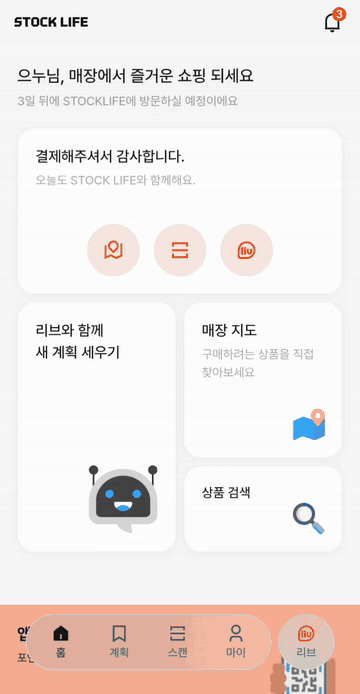
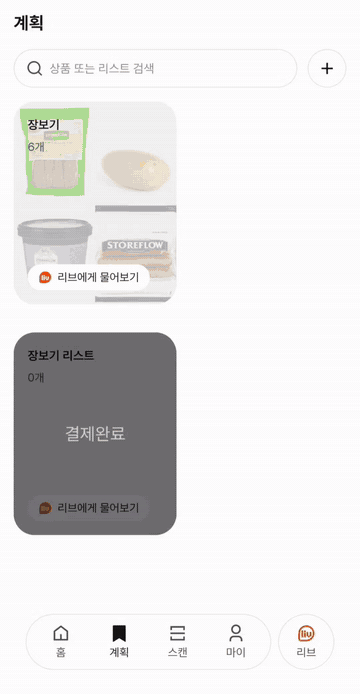

# STOCKLIFE AI 도우미 리브 (Agent)

소비자와 대화하고, 장보는 도중 **먼저 말을 거는** AI 도우미 **리브(liv)** 의 서버예요.
LLM이 상황에 맞는 도구를 골라 백엔드에서 실제 매장 정보를 조회하고, 그 결과로만 답하도록 만들었어요.

> 담당: 팀원 (AI · 데이터)

<p align="center">
  
  &nbsp;
  
</p>

<br>

## 기술 스택

| 구분 | 사용 기술 |
|---|---|
| 서버 | Python, FastAPI, Uvicorn |
| LLM | Anthropic Claude (Tool Use) |
| 예측 모델 | NumPy, pandas, scikit-learn, SciPy |
| 이미지 인식 | SigLIP2 (transformers, PyTorch) — 선택 적재 |
| 통신 | httpx, Server-Sent Events |

<br>

## 무엇을 하나

### 1. 대화형 도우미 (반응형)
소비자가 말을 걸면, LLM이 필요한 **도구(25종)** 를 골라 부르고, 결과를 다시 보고 다음 도구를 고르는 과정을 반복한 뒤 답해요.

| 도구 예시 | 하는 일 |
|---|---|
| `search_products` · `get_product` · `get_inventory` | 상품 검색, 상세, 재고 확인 |
| `compare_products` · `compare_unit_price` | 상품 · 단위 가격 비교 |
| `find_substitutes` | 품절이거나 원하는 상품이 없을 때 대체 상품 |
| `match_preferences` · `predict_repurchase` | 취향에 맞는 상품, 다시 살 때가 된 상품 |
| `predict_availability` | 품절 상품이 언제 다시 채워질지 예측 |
| `identify_product_photo` | 사진 속 상품을 매장 상품과 연결 |
| `optimize_route` · `find_facility` | 매장 방문 순서 정하기, 화장실 · 엘리베이터 위치 |
| `add_to_cart` · `update_cart_quantity` | 대화 중에 리스트에 바로 담기 · 수량 변경 |

### 2. 먼저 말 걸기 (자발형)
세 가지 감시자가 상황을 지켜보다가, 필요할 때 리브가 먼저 메시지를 보내요.

| 감시자 | 보는 것 | 예시 |
|---|---|---|
| **세계** | 매대 이벤트 (재고 · 위치 변화) | 찾던 상품이 다시 입고됐을 때, 상품 위치가 바뀌었을 때 |
| **행동** | 소비자 행동 (조회 · 스캔 등) | 한 상품 앞에서 오래 망설일 때 |
| **시간** | 재구매 시점 | 매장에 들어왔을 때 살 때가 된 상품을 묶어서 브리핑 |

말을 너무 자주 걸지 않도록, **같은 일로는 한 번만, 전체 횟수 제한, 쉬는 시간**을 한 곳에서 관리해요.

### 3. 백엔드 · 프론트를 위한 AI API
상품 대체 추천, 사진 검색, 리스트 분석, 개인화 추천, 재구매 후보, 방문 순서 최적화를 API로 제공하고, 백엔드가 이를 프론트로 중계해요.

<br>

## 설계에서 중요하게 본 것

### 지어낸 매장 정보는 내보내지 않는다
프롬프트로 "도구 결과만 말하라"고 지시해도 LLM이 그걸 보장하지는 않아요.
그래서 답변을 보내기 **직전에**, 답변 속 가격 · 재고 · 위치 · 시각이 실제 도구 결과에서 나온 것인지 대조하는 **검사 단계(guard)** 를 두었어요.
- 근거는 있는데 잘못 옮긴 경우 → 한 번 다시 생성
- 근거 자체가 없는 경우 → 안전한 안내 문구로 대체
- 단, 이미 리스트에 상품을 담은 응답은 다시 생성하지 않아요. 같은 상품이 **두 번 담기는 것**이 틀린 문장보다 더 나쁘기 때문이에요.

### 매장 데이터는 항상 백엔드에서
가격 · 재고 · 위치는 Agent가 따로 들고 있지 않고, 반드시 백엔드 내부 API로 조회해요. "이 숫자는 어디서 왔나?"의 답이 항상 한 곳이 되도록 조회 코드를 한 파일(`sot_client.py`)에 모았어요.

### 모델은 "가장 단순한 방법"을 이겨야 쓴다
재구매 시점, 취향 매칭, 재입고 예측 모델은 여러 후보를 같은 기준으로 비교하고, **단순 평균 같은 기준선을 이긴 경우에만** 실제 서비스에 넣었어요.

### 고칠 때마다 정답 세트로 검증
정답이 정해진 질문 모음(골든셋)을 만들어, 프롬프트나 코드를 고칠 때마다 다시 돌려 무엇이 깨졌는지 확인했어요.

<br>

## 시연용 데이터 생성

실제 매장 데이터가 없어서, 매장과 회원 데이터를 직접 만들어 DB에 넣었어요.

| 폴더 | 만드는 것 |
|---|---|
| `catalog/` | 상품 약 5,000개 (카테고리 체계 포함) |
| `sim/` | 매장 배치 · 재고, 회원 10,000명, 찜, 이산사건 시뮬레이션으로 만든 **90일 구매 · 매대 이력** |
| `models/` | 위 데이터로 학습한 재구매 · 취향 · 재입고 모델 (`app/artifacts/`에 저장) |

<br>

## 폴더 구조

```
Agent/
├── app/
│   ├── main.py              # FastAPI 진입점 (/agent/chat, /health)
│   ├── routes_frontend.py   # 추천 · 사진 검색 등 AI API
│   ├── loop.py              # LLM ↔ 도구 반복 실행
│   ├── guard.py             # 답변 속 매장 정보 검증
│   ├── prompts.py           # 시스템 프롬프트
│   ├── sot_client.py        # 백엔드 조회 (유일한 출입구)
│   ├── etiquette.py         # 먼저 말 걸기 횟수 · 간격 관리
│   ├── tools/               # 도구 정의와 실행
│   ├── watchers/            # 세계 · 행동 · 시간 감시자
│   └── artifacts/           # 학습된 모델 파일
├── models/                  # 예측 모델 학습 · 비교
├── sim/ · catalog/          # 시연용 데이터 생성
├── eval/                    # 골든셋 · 채점
└── *_check.py               # 연동 · 회귀 검사 스크립트
```

<br>

## 실행 방법

```powershell
python -m venv .venv
.\.venv\Scripts\Activate.ps1
pip install -r requirements.txt

Copy-Item .env.example .env      # ANTHROPIC_API_KEY, INTERNAL_SERVICE_KEY 입력
python -m uvicorn app.main:app --port 8000
```

`http://localhost:8000/health`에서 상태를 확인할 수 있어요.

| 환경변수 | 설명 |
|---|---|
| `ANTHROPIC_API_KEY` | Claude API 키 |
| `INTERNAL_SERVICE_KEY` | 백엔드 내부 API 키. 백엔드 `internal.service-key`와 같은 값 |
| `BACKEND_BASE_URL` | 백엔드 주소 (기본 `http://localhost:8080`) |
| `USE_MOCK_SOT` | `true`면 백엔드 없이 목업 데이터로 동작 (기본 `true`) |
| `LOAD_PHOTO_ENCODER` | `1`이면 사진 인식 모델 적재 (약 3.5GB, 기본 `0`) |
| `PHOTO_DEVICE` | 사진 모델 실행 장치 `auto` · `cpu` · `cuda` |

> 사진 인식 모델은 용량이 커서 기본으로는 불러오지 않아요. 사진으로 물어보기 기능을 쓸 때만 `LOAD_PHOTO_ENCODER=1`로 켜세요.
