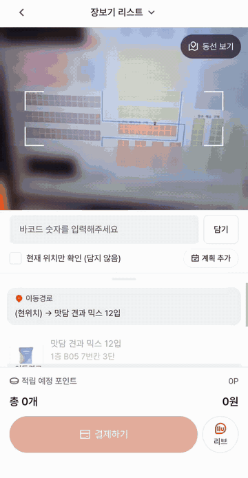
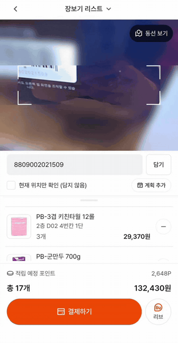
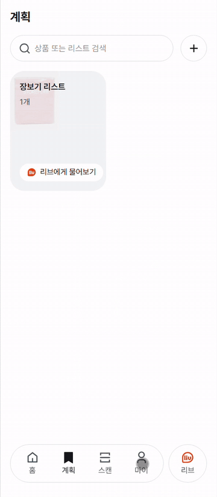
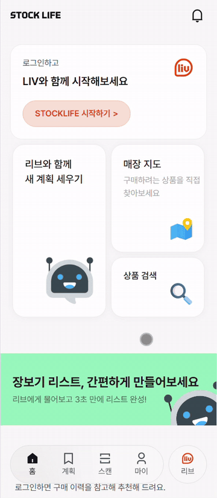
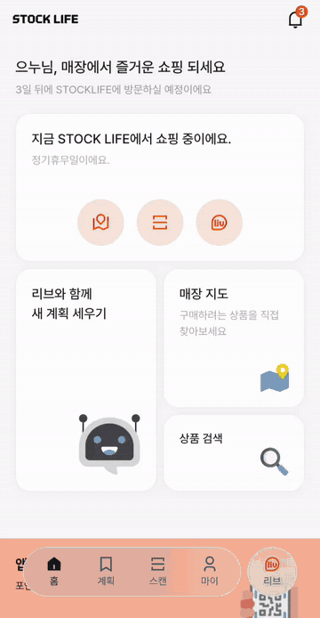
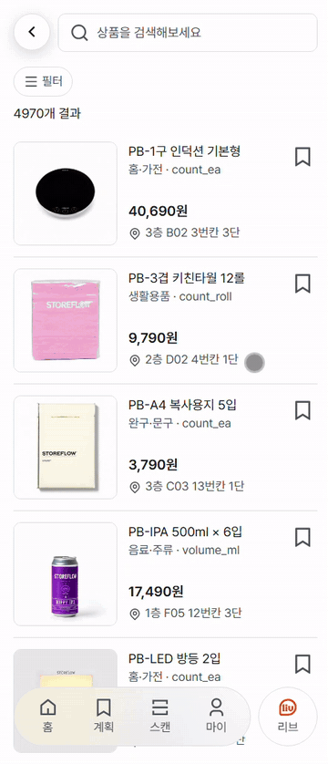
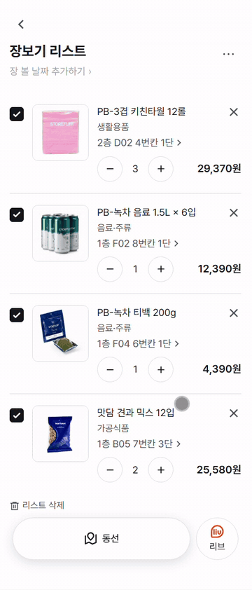
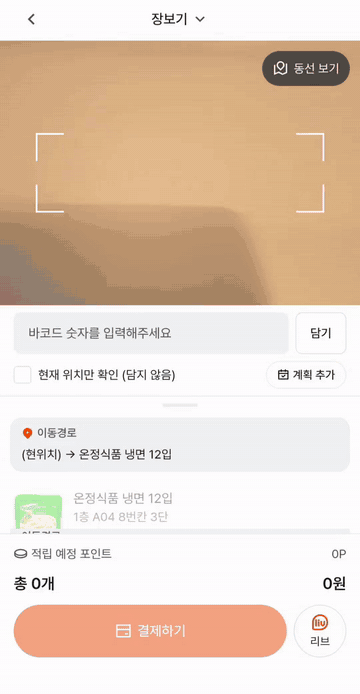
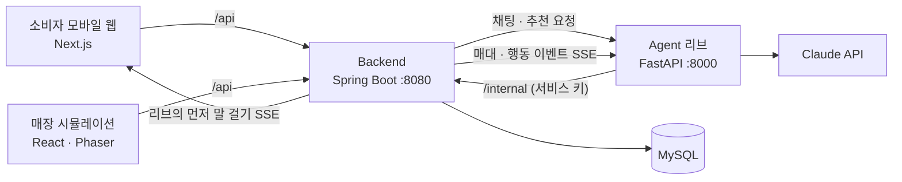

# STOCKLIFE

**창고형 마트 장보기를 처음부터 끝까지 도와주는 AI 쇼핑 도우미.**
무엇을 살지 정하고, 매장에서 어디로 가야 할지 안내받고, 직접 바코드를 찍어 결제까지 앱 하나로 끝낼 수 있습니다.
AI 도우미 **리브(liv)** 가 대화로 상품을 찾아주고, 장보는 도중 먼저 말을 걸어 필요한 걸 챙겨줍니다.

<p align="center">
  
  &nbsp;
  
  &nbsp;
  
</p>

<br>

## 프로젝트 개요

| 항목 | 내용 |
|---|---|
| 기간 | 2026.08 – 2026.09 |
| 인원 | 4명 |
| 과정 | 대한상공회의소 [IBM] Cloud Native Dev base AI Agent 4기 팀 프로젝트 |
| 내 역할 | **프론트엔드 화면 설계 및 구현** |

### 왜 만들었나
창고형 마트는 매장이 넓고 상품이 많아, 살 것을 미리 정하지 않으면 같은 구역을 여러 번 오가게 됩니다.
대용량 상품이 많다 보니 "집에 아직 남아 있는지, 언제 다시 사야 하는지"도 헷갈리고, 장을 다 본 뒤에는 계산대 앞에서 다시 줄을 서야 합니다.

STOCKLIFE는 이 과정을 **계획 → 이동 → 담기 → 결제** 하나의 흐름으로 구성했습니다.

| 단계 | STOCKLIFE가 하는 일 |
|---|---|
| **계획** | 리브와 대화하며 리스트를 만들고, 다시 살 때가 된 상품을 미리 챙길 수 있습니다. |
| **이동** | 리스트 상품의 위치를 따라 층별 동선을 안내합니다 |
| **담기** | 매대 앞에서 바코드를 찍어 바로 담습니다 (Scan & Go) |
| **결제** | 계산대를 거치지 않고 앱에서 결제하고, 전자영수증을 받습니다 |

<br>

## 구성

| 폴더 | 역할 | 기술 | 담당 |
|---|---|---|---|
| [**frontend**](frontend) | 소비자용 모바일 웹 | Next.js 16 · React 19 | **본인** |
| [**Backend**](Backend) | 회원 · 상품 · 리스트 · 주문 · 동선 · 실시간 이벤트 API | Spring Boot 3 · Java 21 | 팀원 |
| [**Agent**](Agent) | AI 도우미 리브 (대화 · 추천 · 사진 인식 · 먼저 말 걸기) | FastAPI · Claude | 팀원 |
| [**Simulation**](Simulation) | 매장 안의 상황을 한눈에 보여주는 시뮬레이션 (앱과 나란히 시연) | React · Phaser 3 | 팀원 |
| `db` | 스키마 · 시드 데이터 · 마이그레이션 SQL | MySQL 8 | 팀원 |

각 폴더의 README에 기능과 실행 방법이 정리되어 있습니다.

<br>

## 주요 기능

### 회원가입 · 리스트

| 회원가입 | 비회원으로 담고 가입 |
|:---:|:---:|
|  |  |
| 전화번호 인증 후 가구 · 반려동물 · 차량 등 생활 정보 입력 | 로그인 전에 만든 리스트를 가입 후에도 그대로 유지 |

### 상품 찾기

| 상품 검색 · 리스트에 담기 | 상세 필터 검색 |
|:---:|:---:|
|  |  |
| 검색한 상품을 원하는 장보기 리스트에 저장 | 카테고리 · 가격 · 판매 상태로 좁혀 찾기 |

### AI 도우미 리브

| 리브에게 물어보기 | 사진으로 물어보기 |
|:---:|:---:|
|  |  |
| 대화로 상품 비교 · 추천, 리스트에 바로 담기 | 사진 속 상품을 인식해 매장 상품과 연결 |

### 매장에서

| 장보러 가기 · 매장 모드 | 바코드로 담기 | 쇼핑 중 물건 추가 |
|:---:|:---:|:---:|
|  |  |  |
| 리스트 상품 위치를 따라 층별 동선 안내 | 바코드를 찍으면 바로 담기고 다음 위치 안내 | 장보는 도중 필요한 상품을 리스트에 추가 |

### 매장 시뮬레이션

STOCKLIFE는 실제 매장 안에서 쓰는 서비스라, 앱 화면만으로는 **손님이 매장 어디에 있고 어떻게 움직이는지** 전달하기 어려울 수 있다고 판단했습니다.
그래서 매장 안의 상황을 쉽게 이해할 수 있도록 **매장 시뮬레이션**을 만들어 앱과 나란히 띄웠습니다

- 실제 도면 기반의 1F · 2F · 3F 매대와 시설 위에서 손님 캐릭터가 이동
- 앱의 장보기 리스트를 불러와 방문 순서대로 동선을 그리고 캐릭터가 따라 이동 (엘리베이터 · 에스컬레이터 포함)
- 매대 앞에 띄운 바코드를 앱 카메라로 찍어, 실제 매장에서 스캔하는 장면을 시연
- 재고를 채우는 이벤트를 만들어, 리브가 "찾던 상품이 다시 들어왔어요"라고 먼저 말을 거는 장면을 재현

→ [Simulation README](Simulation)

### 결제

| 결제 · 전자영수증 |
|:---:|
|  |
| 포인트 사용 · 결제수단 선택, 결제 후 전자영수증 확인 |

<br>

## 아키텍처



- **프론트는 백엔드하고만 통신합니다.** 리브와의 대화도 백엔드를 거쳐 Agent로 전달됩니다.
- **Agent는 매장 데이터를 직접 가지지 않습니다.** 가격 · 재고 · 위치는 항상 백엔드의 내부 API로 조회하고, 답변에 들어간 매장 정보가 실제 조회 결과와 맞는지 검사한 뒤에 내보냅니다.
- 소비자의 행동(스캔 · 검색 · 조회)과 매대 변화가 실시간으로 Agent에 전달되고, Agent가 필요하다고 판단하면 프론트로 **먼저 말을 걸 수 있습니다.**

<br>

## 기술 스택

| 영역 | 기술 |
|---|---|
| Frontend | TypeScript, Next.js, React, Tailwind CSS, shadcn/ui |
| Backend | Java 21, Spring Boot, Spring Data JPA, JWT |
| AI | Python, FastAPI, Anthropic Claude (Tool Use), scikit-learn, SigLIP2 |
| Database | MySQL 8 |
| Infra | AWS (서버, RDS), Docker, Nginx |
| Simulation | React, Phaser 3, Vite |

<br>

## 내가 맡은 부분

소비자가 만나는 **모바일 웹 화면 전체**를 설계하고 구현했습니다.

- 홈 · 검색 · 리스트 · 리브 채팅 · 매장 모드(스캔) · 결제 · 마이페이지 · 회원가입 화면
- **어느 기기에서나 되는 바코드 스캔**: 일부 브라우저에서만 되던 내장 API 대신 JS 라이브러리로 교체
- **매장 동선 안내**: 지도 위에 리스트 상품 위치와 통로를 따라가는 경로 표시, 확대 · 이동 지원
- **리브 채팅**: 텍스트 · 음성 입력 · 사진 첨부, 리브가 먼저 보낸 메시지를 실시간으로 받아 알림함과 연결
- **비회원 → 회원 리스트 승계**: 로그인 전에 만든 리스트를 가입 후 서버로 옮기고, 의도치 않은 데이터가 넘어가던 문제 수정
- **PC에서도 모바일 화면으로 표시**: 화면 폭과 상관없이 모바일 레이아웃이 유지되도록 화면 틀 구성

자세한 내용은 [frontend README](frontend)에 있습니다.

<br>

## 폴더 구조

```
stocklife/
├── frontend/      # 소비자 모바일 웹 (Next.js)
├── Backend/       # API 서버 (Spring Boot)
├── Agent/         # AI 도우미 리브 (FastAPI)
├── Simulation/    # 매장 시뮬레이션 (React · Phaser)
├── db/            # 스키마 · 시드 · 마이그레이션 SQL
├── docs/          # 통합 · 배포 기록, README 이미지
└── docker-compose.yml   # 로컬 MySQL
```

<br>

## 배포

프로젝트 기간 동안 AWS에 배포해 시연했습니다.

| 구성 | 방식 |
|---|---|
| frontend · Backend | 웹 서버에서 Docker 컨테이너로 실행 |
| Simulation | 정적 빌드 → Nginx가 `/simulation/` 경로로 제공 |
| 라우팅 | Nginx가 한 도메인 아래에서 frontend(`/`)와 Simulation(`/simulation/`)을 함께 제공 (TLS 적용) |
| Agent | 별도 서버에서 Uvicorn으로 실행 (사진 인식 모델 포함) |
| DB | AWS RDS (MySQL, 서울 리전) |

- frontend와 Simulation을 **같은 도메인**에 두어, Simulation 화면 안에 띄운 앱과 로그인 정보(토큰)를 공유합니다.
- 채팅 사진처럼 서버에 저장되는 파일은 배포 버전과 분리된 폴더에 두어, 재배포해도 사라지지 않게 했습니다.

<br>

## 실행 방법

필요한 것: Docker, JDK 21, Node.js, Python 3, Git Bash(DB 적재용)

```powershell
# 1. 로컬 MySQL (Docker, 3307 포트) — 저장소 루트에서
docker compose up -d

# 2. 스키마 · 시드 데이터 적재 (최초 1회) — Git Bash에서 저장소 루트 기준
#    PC에 mysql 클라이언트가 없으면 Docker로 대신 실행
DOCKER_MYSQL=1 bash db/load_all.sh -h host.docker.internal

# 3. Backend (Java 21)
cd Backend
.\gradlew.bat bootRun

# 4. Agent (Python)
cd Agent
pip install -r requirements.txt
python -m uvicorn app.main:app --port 8000

# 5. frontend
cd frontend
npm install
npm run dev

# 6. Simulation (선택 — 매장 시뮬레이션과 앱을 나란히 보기)
cd Simulation
npm install
npm run dev
```

| 화면 | 주소 |
|---|---|
| **앱 단독** | http://localhost:3000 |
| **시뮬레이션 + 앱 (시연 화면)** | http://localhost:5173/simulation/ |
| Backend | http://localhost:8080 |
| Agent | http://localhost:8000/health |

- 시뮬레이션 화면은 오른쪽에 앱(frontend)을 함께 띄우기 때문에, **frontend(3000)도 켜져 있어야** 합니다.
- 각 서비스의 설정 파일(`.env`, `application.yml`)은 폴더별 `example` 파일을 복사해서 만듭니다. Backend의 `internal.service-key`, Agent의 `INTERNAL_SERVICE_KEY`, Simulation 실행 시의 `INTERNAL_SERVICE_KEY` 환경변수는 모두 같은 값이어야 합니다.
- DB 적재 순서와 주의할 점은 `db/README_시드적재.md`에 있습니다.
